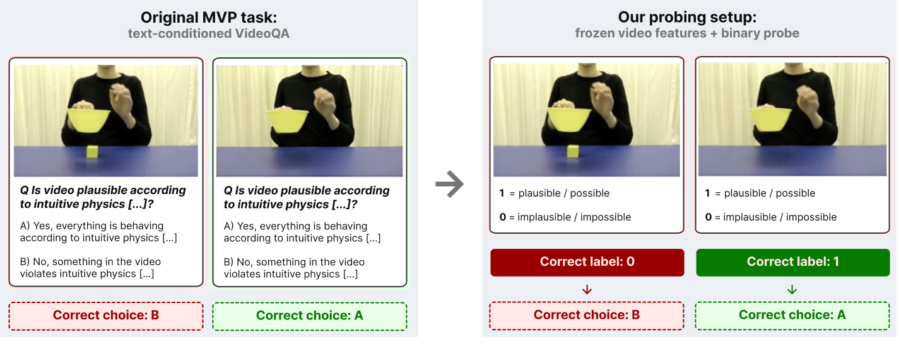

<h1 align="center">
  How Do Video Foundation Models Encode Intuitive Physics?<br>
  Probing Across Pretraining Paradigms
</h1>

<h3 align="center">NeurIPS 2026 Workshop on World Models in Physical AI</h3>

<p align="center">
  <a href="https://scholar.google.com/citations?user=uBrcokoAAAAJ">Samuele Punzo</a><sup>*</sup>,
  <a href="https://scholar.google.com/citations?user=zAzUbX0AAAAJ">Niccolò Caselli</a><sup>*</sup>,
  <a href="https://openreview.net/profile?id=~Ippokratis_Pantelidis2">Ippokratis Pantelidis</a><sup>*</sup>,<br>
  <a href="https://scholar.google.com/citations?user=Mijp4OoAAAAJ">Francesco Massafra</a><sup>*</sup>,
  <a href="https://scholar.google.com/citations?user=TzWJ0VQAAAAJ">Salvatore Lo Sardo</a><sup>*</sup>,
  <a href="https://scholar.google.com/citations?user=kpT3gcsAAAAJ">Mohammadreza Salehi</a><sup>†</sup>
</p>

<p align="center">
  University of Amsterdam<br>
  <sub><sup>*</sup> Equal contribution &nbsp; <sup>†</sup> Supervisor</sub>
</p>

<p align="center">
  <a href="docs/reproduction.md"></a>
  <a href="CITATION.cff"></a>
  <a href="environment.yml"></a>
  <a href="environment-gpu.yml"></a>
</p>

<p align="center">
  <b>Probe4Physics</b> · Official code and saved results for the paper.<br>
  <sub>Published June 8, 2026</sub>
</p>

<p align="center">
  
</p>

<p align="center">
  <em>Adapting MVP to video-only physical-plausibility probing (Figure 5).</em><br>
  <sub>Video frames adapted from MVP (Krojer et al., 2025).</sub>
</p>

---

## Overview

This work studies the accessibility of physical-plausibility information in
frozen video foundation model representations. It provides a shared pipeline for
dataset preparation, feature extraction, probe training, and evaluation across
predictive joint-embedding, masked-reconstruction, and video-diffusion models.
Separate probes operate on intermediate representations, allowing comparisons
across network depth, backbone variants, and readout capacity without updating
the pretrained backbone.

| Component       | Supported scope                                                        |
| --------------- | ---------------------------------------------------------------------- |
| Benchmarks      | Minimal Video Pairs (MVP), IntPhys2                                    |
| Backbones       | V-JEPA, V-JEPA 2, V-JEPA 2.1, VideoMAE, VideoMAE-v2, LTX-Video         |
| Probes          | Linear, MLP, temporal attentive                                        |
| Primary metrics | MVP pair consistency; IntPhys2 violation-of-expectation (VOE) accuracy |
| Controls        | Temporal displacement, repeated single frame, structured random labels |

MVP is adapted to a video-only binary plausibility task. IntPhys2 uses supervised
scene-level train/validation/test partitions. Scores therefore belong to this
probing protocol and should not be interpreted as directly comparable to the
original benchmarks' published evaluations. Probe performance measures
decodability; it does not establish that a backbone actively uses the recovered
information for physical reasoning.

## Installation

Run commands from the repository root. Initialize the recorded upstream versions:

```bash
git submodule update --init --recursive
conda env create -f environment.yml
conda activate probe4physics
python run.py help
python run.py health.layers strict_exit=true
```

Python 3.11 is the environment target. The standard environment supports CPU
probe training and result analysis. For CUDA workloads, use the separate GPU
environment, which specifies PyTorch 2.6.0 and CUDA 12.4 wheels:

```bash
conda env create -f environment-gpu.yml
conda activate probe4physics-gpu
```

Choose an environment compatible with the execution host. GPU feature extraction
and token-level attentive training require substantially more memory than pooled
linear or MLP probing. The environment definitions are dependency specifications,
not exact historical locks. See [validation](docs/validation.md) for the versions
actually checked during release preparation.

## Data and checkpoints

Prepare MVP videos using the upstream benchmark's setup instructions. The
`init.mvp` command can obtain annotations, applies the existing binary
plausibility selection, and creates grouped splits; it does not download the
complete video collection. IntPhys2 has a dedicated downloader:

```bash
python run.py download.intphys2
python run.py init.intphys2
python run.py init.mvp
```

Default video roots are `data/videos/mvp` and `data/videos/intphys2`. Supply
`videos_root=/absolute/path` when using an existing collection. Feature caches
normally live under `artifacts/features/<dataset>`; override `feature_cache.dir`
when necessary. Environment variables provide equivalent defaults, documented
in [data preparation](docs/data.md).

Backbone variants, input sizes, local checkpoint filenames, and Hugging Face
identifiers are defined in [configs/backbones.yaml](configs/backbones.yaml).
JEPA checkpoints must be obtained from their upstream releases; the expected
variants and filenames are listed in the backbone configuration. VideoMAE and LTX adapters resolve the configured remote
models when extraction is run. Initial model access requires network availability
and compliance with each model's terms. Explicit checkpoints can be supplied
with `+backbone.kwargs.checkpoint_path=/absolute/path` where supported.

Raw datasets, pretrained weights, feature caches, and trained probe checkpoints
are not bundled in this checkout.

## Reproducing the paper

### Regenerate analyses from saved results

The versioned `results/` directory contains measurement workbooks, configuration
records, and seed summaries. Verify these inputs, then execute the paper notebooks
in a disposable copy:

```bash
python scripts/verify_release_inputs.py
python scripts/reproduce_notebooks.py --output-dir output/reproduction/paper
```

Use a new output directory for each run. The command preserves source notebooks
and result files, writes executed notebooks and CSV exports, and records cell
errors in `report.json`. Figures remain embedded in the executed notebooks;
notebooks that already export images also write them inside the copied tree.
To execute one analysis:

```bash
python scripts/reproduce_notebooks.py \
  --output-dir output/reproduction/backbones \
  --notebooks backbone_ablation
```

Successful notebook execution does not establish complete agreement with every
paper number. Some historical seed artifacts and random-label checkpoints are
not bundled; their availability is exposed by the existing notebook diagnostics.
The [reproduction index](docs/reproduction.md) maps every numbered paper table
and figure to its inputs, generating code, outputs, and remaining gaps.
[The result inventory](results/README.md) explains which files serve each role.

### Rerun experiments

Full reproduction requires prepared videos, pretrained models, sufficient
CPU/GPU resources, and the appropriate per-layer configurations. Follow
[the experiment guide](docs/experiments.md) for extraction, Optuna studies,
fixed-config seed runs, and controls. Use the saved experiment manifests to
recover historical settings; generic defaults alone do not specify every paper
experiment. Keep the recorded seeds, splits, preprocessing, and selected
configurations when comparing regenerated measurements with the saved results.

## Running an experiment

After preparing MVP videos and downloading a V-JEPA checkpoint, the following
runs a linear probe on layer 24 of the ViT-H encoder:

```bash
python run.py init.mvp
python run.py extract.mvp \
  backbone.name=jepa_v1 +backbone.kwargs.variant=vith16_384 \
  +backbone.kwargs.checkpoint_path=/absolute/path/to/vith16-384.pth.tar \
  backbone.kwargs.device=cuda
python run.py train_eval.probe.mvp \
  backbone.name=jepa_v1 +backbone.kwargs.variant=vith16_384 \
  +backbone.kwargs.checkpoint_path=/absolute/path/to/vith16-384.pth.tar \
  backbone.kwargs.device=cuda \
  probe.name=linear probe.layer=24 probe.device=cpu
```

Use the same backbone overrides when loading the cache as during extraction.
Splits are written below `data/splits/`; caches contain an index, feature tensors
or chunks, and a manifest. Probe outputs include `probe_best.pt`,
`probe_last.pt`, training summaries, predictions, and benchmark metrics under
`artifacts/`. Output directories are configurable. Cache validation prevents
silently combining incompatible representations. Consult the experiment guide
before changing paths for an existing resumable extraction.

## Repository structure

```text
benchmarks/   Dataset selection, grouped splits, loading, and scoring
models/       Frozen backbone adapters and feature contracts
probes/       Trainable readouts
training/     Extraction and probe orchestration
configs/      Dataset and backbone configuration
experiments/  Recipes and readiness checks
scripts/      Reproduction and result collection tools
notebooks/    Paper analysis and plotting
results/      Saved experimental evidence and configuration records
docs/         Detailed instructions and provenance
tests/        CPU tests and fixtures
third_party/  Recorded upstream implementations
```

Generated feature caches, checkpoints, executed notebooks, figures, and logs
belong in ignored `artifacts/`, `output/`, or `logs/` directories. The structure
above lists the shared paper workflow; development branches may also contain
additional research and cluster utilities.

## Validation and development

```bash
python -m unittest discover -s tests -q
python scripts/verify_release_inputs.py
python run.py exp.list
```

CPU CI runs the retained tests and checks the public command interface and layer
configuration. `python run.py health` inspects dataset and model readiness;
`python run.py health.features` checks existing feature caches. These checks may
report missing external assets on a fresh checkout. See
[development](docs/development.md) and [validation](docs/validation.md) for test
scope and limitations.

## Citation

Citation metadata is also available in [CITATION.cff](CITATION.cff).

```bibtex
@inproceedings{punzo2026probe4physics,
  title = {How Do Video Foundation Models Encode Intuitive Physics?
           Probing Across Pretraining Paradigms},
  author = {Punzo, Samuele and Caselli, Niccolò and Pantelidis, Ippokratis
            and Massafra, Francesco and Lo Sardo, Salvatore
            and Salehi, Mohammadreza},
  booktitle = {NeurIPS 2026 Workshop on World Models in Physical AI},
  year = {2026}
}
```

## Acknowledgments and licensing

This work uses MVP, IntPhys2, V-JEPA, VideoMAE, and LTX-Video. Dataset, model,
and upstream code attribution is recorded in [third-party documentation](docs/third_party.md).
These assets retain their respective licenses and access conditions. A license
for this project’s own code has not yet been selected.
